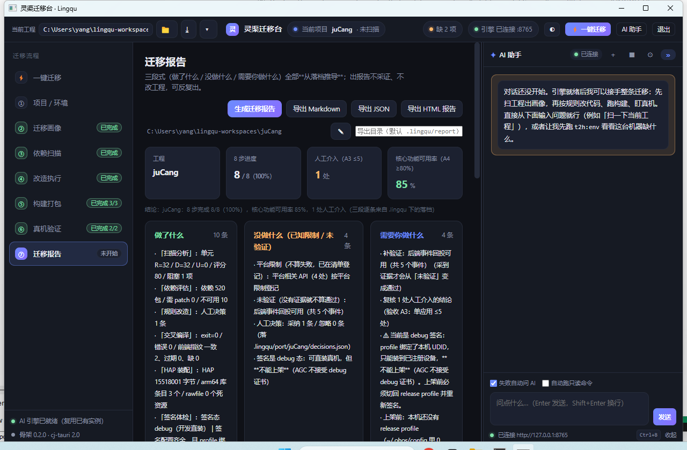
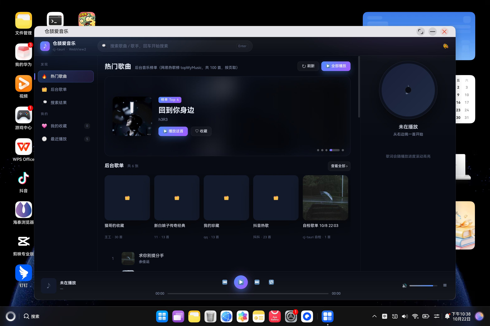

<div align="center">

# 灵渠 · Lingqu

**Tauri 应用 → 鸿蒙 PC 的一站式 AI 迁移台**

把「照几千字踩坑笔记手工移植一个 Tauri 应用」变成**一条命令 + 一份带证据的迁移报告**；
而且**踩过的坑会自己长成下一轮的规则、指纹与技能**。

[](./CHANGELOG.md)
[](./scripts/test.sh)
[](#-测试与质量)
[](https://cangjie-lang.cn)
[](#-平台与验证范围)
[](./LICENSE)

[30 秒了解](#-30-秒了解) · [为什么是它](#-为什么是它) · [AI 自动进化飞轮](#-ai-自动进化飞轮本项目的特色) · [截图](#-截图) · [能做什么](#-能力矩阵) · [快速开始](#-快速开始) · [测试与质量](#-测试与质量) · [架构](#-架构) · [命令表](#-命令表) · [文档](#-文档地图) · [路线](#-路线与质量目标)

</div>

> **English TL;DR** — Lingqu is a desktop workbench (Cangjie + `cj-tauri` shell, built-in
> [`cjh`](https://atomgit.com/qq8864/cjh) coding-agent engine) that migrates real Tauri apps to
> **HarmonyOS PC**: scan → dependency matrix → rule-based code rewrite → cross-compile → HAP assembly →
> automatic signing (AGC) → `hdc` deploy → on-device verification → risk-graded report.
> **The agent is the worker, the tools are its hands, humans only step in when it asks** (ADR D-015).
> Its distinguishing feature is a **self-evolution flywheel**: the agent writes its own lessons to
> `<project>/.lingqu/notes/`, unknown errors accumulate as normalized signatures in
> `.lingqu/diagnose/misses.jsonl`, and only after human review do they become fingerprints / rules / skills
> that the next run consumes. 396 unit tests, six local gates, MIT.

---

## 🎯 30 秒了解

| | |
|---|---|
| **是什么** | 一个**桌面工作台**（仓颉外壳 + 8 屏导航 + 右栏 AI 面板），把「把一个真实 Tauri 应用迁到鸿蒙 PC」做成**看得见、可断点、有证据**的流水线 |
| **谁在做迁移** | **内置的 AI agent `cjh`**（进程外 `127.0.0.1:8765`，REST + WS）。我们不替它决定每一步怎么做，只给它**器官**（`t2h:*` 命令、`lingqu-cli`、落档、技能、轮次预算）和**刹车**（预算 / 停滞 / 一键停止） |
| **凭什么叫完成** | **落档说了算**：`.lingqu/<步骤>/<工程>.json` 里的判定字段通过才算通过；退出码 0 不算、AI 说"好了"也不算 |
| **为什么是仓颉** | 外壳（`cj-tauri`）、迁移引擎、AI 引擎（`cjh`）同栈；一个业务包 `src/` 编出桌面与鸿蒙两端产物，没有 Node/Python 运行时依赖 |
| **特色** | **AI 自动进化飞轮**：经验与未命中错误由 agent 自己落盘，攒够次数后由人裁决进指纹 / 规则 / 技能库，下一轮自动吃上（见 [专章](#-ai-自动进化飞轮本项目的特色)，设计细节见 [`docs/AI自进化飞轮.md`](docs/AI自进化飞轮.md)） |
| **现状** | **v0.39.56**：37 个 `t2h:*` 命令 · 20 条 CLI 子命令 · 396 例单测 · 15 条改造规则 · 20 条错误指纹 · 8 步流水线六项门禁全绿；**3/5 样本**已跑到真机验证（habit-tree 100% / m3u8dl-tauri 100% / juCang 85%） |

---

## 💡 为什么是它

把灵渠和「拿一堆散装脚本/技能包 + 让 AI 现场发挥」的路线放在一起比，差异不在单个功能，而在**形态**：

| | 传统「技能包 / 散装 CLI」路线 | **灵渠** |
|---|---|---|
| **感知全景** | 雁过不留痕：技能是静态文档，agent 撞了什么坑、走到哪一步、哪步卡住——散落在会话与日志里，**没有一处能看到移植的全貌** | **8 步流水线全程落档**（`.lingqu/<步骤>/<工程>.json`）：迁移画像（五类清单 + 评分 + C1/C2/C3）、依赖矩阵、改造 diff、构建闸门、真机证据——**每一步都看得见、可断点、可回滚** |
| **生命周期** | 一次会话 = 一次搬运：会话关了，上下文就没了；换个应用、隔两周再回来，从零开始 | **断点续迁 + 任务状态机**：工程停在哪一步、哪些过了哪些没过，落档说了算；随时接着跑 |
| **迁移质量** | 「跑完了」≈「能用了」：退出码 0 就算成功，白屏、旧 .so、假安装都发现不了 | **落档说了算 + 六项门禁 + 真机证据链**：判定字段写进 JSON 才算通过；真机截图 / hilog / dumpLayout 四段判据，报告里「100%」和「尚未验证」不会打架 |
| **经验沉淀** | 技能包靠人写人维护：写完就旧，AI 撞到新坑也无法自行记账；**雁过不留痕** | **AI 自动进化飞轮**：agent 自己写经验（四段式）、机器攒未命中证据、人只做裁决——指纹 / 规则 / 技能**从真实迁移里长出来**，下一个应用自动吃上 |
| **上手成本** | 用户自己装环境、找技能、配 prompt、拼 CLI：工具越好用，前置功课越多 | **开箱即一台完整工作台**：内置 AI 引擎（cjh 随包分发、SHA256 校验、自动拉起），37 个 `t2h:*` 命令 + 20 条 CLI 子命令开箱即用；一条 `migrate` 从源码到真机 |
| **谁来干活** | 人写 prompt 驱动 AI，AI 每一步都要人盯着 | **agent 是执行者，工具是它的手**（ADR D-015）：任务书交出去，AI 自己跑流水线；停滞/超预算才叫人，人工介入逐次记录（验收 A3 ≤5 处的口径） |

一句话：**技能包给 AI 一本攻略书，灵渠给 AI 一条带闸门的流水线和一个会自己写攻略的大脑。**

攻略书会过时，流水线不会——每迁一个应用，流水线上的证据都沉淀进飞轮，这正是
[AI 自动进化飞轮](#-ai-自动进化飞轮本项目的特色)那章所描述的机制。

---

## 🚀 AI 自动进化飞轮（本项目的特色）

迁移工具的通病是**每次迁移都从零开始**：这次的报错、这次的绕法，写在会话里、日志里、人的脑子里，
下一个应用再来一遍。灵渠把它做成一个**闭环**：干活的 agent 自己写经验，机器攒证据，人只做裁决。


**关键设计（为什么不是"让 AI 自己改技能库"）**

| 决策 | 理由 |
|---|---|
| 认知层**不许全自动写** | 指纹与规则会**直接指挥 agent 改用户工程**（动 `Cargo.toml` / `lib.rs` / `hvigorfile.ts`）——人复核一条规则 5 分钟，一条错规则毁掉一个样本的可信度 |
| **不热替换**本地 `skills/` | 技能正文进 **system prompt**，热替换 = prompt 漂移：行为变了却没人知道为什么 |
| 只记**验证过**的事 | 四段里的「修法」必须是实际生效的那个；空标题直接拒绝写盘 |
| 次数 = 可信度代理 | 1 次可能是命令写错，≥2/≥3 次基本就是系统的脾性 |
| 内容走**文件**不走参数 | 仓颉程序在 Windows 上接不了非 ASCII 的 `argv`（`AGENTS.md` §4-119）→ `--body <json>` |

**它是否真在转，看这四个数**：`notes` 条数（↑ 说明 agent 在记）· 同签名未命中次数（补完指纹后应停止增长）·
指纹/规则条数（缓慢 ↑，只收通用的）· 人工介入 A3 与可用率 A4。

> 完整技术文档（五层结构、七个环节的接口与判据、数据结构、度量、纪律与反例、已知边界、演进路线）：
> **[`docs/AI自进化飞轮.md`](docs/AI自进化飞轮.md)**；
> 入库标准与格式（三条件 + 三追问、四段 → `pitfalls.md` 三段 的映射与示例、反例、PR 清单）：
> **[`docs/经验入库规则.md`](docs/经验入库规则.md)**

---

## 📸 截图

**① 工作台（真实窗口，1280×840）** — 左栏 8 屏导航与六项徽标、中栏当前步骤、右栏 AI 面板；
顶栏是当前工程，AI 引擎状态在页脚（`WS 已连接 / 引擎 running`）。


**⑦ 迁移报告屏（真实落档生成）** — 结论一行（8 步 8/8、可用率 85%、人工介入 1 处）、**风险分级**（高 0 / 中 3 / 低 3，共 6 条）、
三段式正文（做了什么 / 没做什么 / 需要你做什么）与「迁移矩阵」。



**真机侧（鸿蒙 PC，HAD-W32 / HarmonyOS 7.0.0.111 / API 26）** — Rust+ArkWeb 混合应用在真机上的运行画面：



> 截图口径：前两张是**真实应用窗口**（`CopyFromScreen` 抓取本应用窗口区域，非示意图）；
> 报告屏那一张是用 `LINGQU_UI_PROBE=risk` 触发一次真实的 `t2h:report` 后截的（报告内容 100% 来自落档）。
> 第三张是 cj-tauri `examples/ohos/ohos-music` 在鸿蒙 PC 真机上的运行画面——**下一个迁移样本
> [`rust-music`](https://atomgit.com/qq8864/rust-music)（Rust + Tauri 2 的同口径对照实现）的移植目标形态**。
> **界面里没有示意数据**——所有数字都绑定真实落档（§4-94/§4-95）。

---

## 📋 能力矩阵

| 能力 | 状态 | 证据 |
|---|---|---|
| **8 步迁移流水线**：扫描 → 依赖矩阵 → 规则改造 → 交叉编译 → HAP 装配 → 签名 → 真机部署 → 真机验证（+ 报告 / 断点续迁 / 批量矩阵） | ✅ 全部落地 | `t2h:scan/deps/port/build/hap/sign/deploy/verify/report/resume/batch` |
| **规则改造**（确定性，幂等可回滚） | ✅ 15 条规则 | `R2-PORT-001…015`（含 0.39.53 的 015：自动注掉 hvigorfile 的 tauri 钩子，修 `00308018`） |
| **错误指纹库**（命中不调模型） | ✅ 20 条 | `FP-001…FP-020`，`t2h:diagnose` 命中即给修法 |
| **HAP 装配 + 闸门** | ✅ 真机 15 MB 级产物 | 点名校验 `lib<module>.so`、前端指纹闸（`.so` 内嵌 AssetKey ↔ `dist/`） |
| **自动签名（路线 A：AGC 云生成）** | ✅ 真机打通 | `sign --auto` 一条命令 → `signed=true` + `install bundle successfully`，**不需要打开 DevEco** |
| **真机部署与验证** | ✅ 3 个样本 | `hdc install` / `aa start` / `hilog` / `uitest dumpLayout` 四段判据；可用率 habit-tree 100% · m3u8dl 100% · juCang 85% |
| **AI 一体化**：一键迁移（后台 8 步）+ **把任务书交给 cjh 让它自己干** | ✅ 实机跑过 | `t2h:migrate` / `t2h:autoport_*`；juCang 一轮 AI 自动迁移 8/8 |
| **报告**：三段式 + 风险分级 + 自动出报告 | ✅ | `t2h:report`；AI 路径跑完自动出报告（0.39.54） |
| **AI 自动进化飞轮**：经验落盘 + 未命中台账 + **候选池（suggest/archive）** → 认知层 | ✅ 实现（agent 侧实跑观察中） | `t2h:notes` / `t2h:diagnose` + `notes_test` 24 例；阶段 1 已端到端实测（候选门槛三层生效、入库后出池）；**未验**：agent 在真实迁移途中是否照做 |
| 5 样本矩阵 | 🔶 3/5 已验证 | `t2h:batch`；cc-switch / tauri-mqtt / atomMqtt 待推到验证 |

---

## ⚡ 快速开始

**前置**：仓颉 SDK 1.0.5（`cjpm` / `cjc`）、[cj-tauri 框架仓](https://atomgit.com/qq8864/cj-tauri)
（含 `native/libcjtbridge.dll` 与 `native/webview2/WebView2Loader.dll`）、stdx。
详细环境变量表见 [`docs/开发环境.md`](docs/开发环境.md)。

```bash
git clone https://atomgit.com/qq8864/lingqu.git && cd lingqu

./scripts/setup.sh              # 环境体检（只校验，不改任何文件）
./scripts/test.sh -s            # 六项门禁（首次会派生 targets/ 骨架）
./scripts/run-dev.sh -b         # 编译 + 起窗口（AI 引擎自动拉起；需要模型 Key）
```

Windows 用 `scripts\test.bat -s` / `scripts\run-dev.bat`（参数相同）。
**脚本一律 bash 为准，`.bat` 只做「找 bash 再委托」**——一份实现、两个平台（ADR D-012）。

给 AI 引擎配模型（也可以在工作台「设置」里点，写的是 cjh 自己的配置）：

```bash
export DEEPSEEK_API_KEY=sk-xxx      # 或 OPENAI_API_KEY / DASHSCOPE_API_KEY / CJH_API_KEY
```

### 迁一个应用（最小路径）

```bash
lingqu-cli scan   --path <工程>            # 五类清单 + 评分 + 覆盖率（C1/C2/C3）
lingqu-cli deps   --path <工程>            # Cargo 依赖 → OHOS 兼容矩阵 + 替代建议
lingqu-cli port   --path <工程>            # 15 条规则改造（幂等 / 可回滚 / 决策可审计）
lingqu-cli build  --path <工程>            # 交叉编译 + .so 前端指纹闸
lingqu-cli hap    --path <工程>            # HAP 装配（点名校验 lib<module>.so）
lingqu-cli sign   --auto --path <工程>     # AGC 自动签名（唯一人工介入：浏览器授权一次）
lingqu-cli deploy --path <工程> --start    # hdc 装机 + 拉起 + hilog
lingqu-cli verify --path <工程>            # 功能清单 → 可用率
lingqu-cli report --path <工程>            # 三段式报告 + 风险分级

# 或者：一条命令跑完 8 步（卡住时留给 AI 接着干）
lingqu-cli migrate --path <工程> --wait
```

**落档说了算**：`.lingqu/<步骤>/<工程>.json` 写着通过才算通过。
GUI 里对应的入口是「🤖 开始 AI 自动迁移」（`t2h:autoport_start`：准备现场 → 交任务书 → 盯落档 → 停滞/预算时叫人）。

### 打包分发

```bash
bash packaging/pack-win-single-full.sh   # 真·单文件：产物只有一个 main.exe（cjh 与 WebView2Loader 变 PE 资源，运行期释放）
bash packaging/package-win.sh            # 常规目录包（DLL 按导入闭包自动收，漏一个就启动即退 0xC0000135）
```

---

## 🧪 测试与质量

**一句话**：`./scripts/test.sh` 是**唯一交付凭证**——六项全绿才算能交付，而且每一项都要求"看得到明细"。

```
[0] cj-tauri sync         清单 → 派生 targets/（改了 cj-tauri.toml 才需要 -s）
[1] 业务包 cjpm build      零警告（unused / deprecated 一律清零，禁止"先交付后清理"）
[2] 业务包 cjpm test       396 例 / 45 个 *_test.cj，FAILED=0 且 ERROR=0
[3] cj-tauri check        清单校验 + 骨架漂移 + 能力三方比对（声明 × 插件自述 × 实际装配）
[3b] 页面脚本语法          抽出 index.html 的 <script> 块逐个 node --check
[4] targets/desktop build  骨架侧也要编得过且零警告
[5] cli build             AI 用的命令行入口也要编得过且零警告
```

| 质量手段 | 具体做法 | 真实产出 |
|---|---|---|
| **测试只测纯函数** | 进程 / 网络 / WebView2 / 真机部署**不在单测里造假绿**，这类以实机为准 | 396 例覆盖扫描器、依赖解析、规则改造、HAP 闸、签名判定、风险分级、扫描口径… |
| **bug 先红后绿** | 修 bug 必须先写复现用例（红）再修（绿） | 本轮 0.39.55 的 3 个真 bug 就是单测当场抓出来的（见下） |
| **零警告是硬判据** | 门禁统计 `warning:` 行数并**打印明细**（只报条数等于没检查） | 0.39.0 曾因"删调用方留下 unused"栽过，之后写进规矩 |
| **界面可自动断言** | `t2h:ui_report` 回投版面指标（grid 列宽 / 当前屏 / JS 错误数 / 面板状态 / 200+ 字段）落 `.lingqu/ui-report.{json,log}` | 没有视觉也能证明版面对；本轮两个截图也是这么验的（像素体检：239/300 种颜色，非空白） |
| **落档即证据** | 每步判定写 `<工程>/.lingqu/<步骤>/<工程>.json`，失败要把闸门第一条 `failures` 贴出来 | 报告、风险分级、断点板、矩阵全部只读落档，不猜 |
| **真机口径不靠退出码** | `hdc` 失败也返回 0 → 只按输出文本判（`install bundle successfully` / `start ability successfully`）；界面是否真画出来用 `uitest dumpLayout` 断言 | 白屏、锁屏、异签名装机这些历史坑都是这么定位的 |
| **踩坑清单** | `AGENTS.md` §4 **119 条**，每条写"现象 → 根因 → 正确做法"，并要求同批进文档 | 本轮新增 §4-116~119（逐字节 UTF-8 / 美化 JSON / 全角空格 / 非 ASCII argv） |

**单测当场抓出的真 bug（0.39.55，都能过编译、跑起来必错）**

| # | 现象 | 根因 |
|---|---|---|
| 1 | 中文标题一进"经验合并"就崩 | 逐字节 `String.fromUtf8([b])`——单个字节不是合法 UTF-8（§4-116，与 §4-113 同族） |
| 2 | 经验里的 `工程` 字段变成 `juCang　时间：…` | 多字段行没在全角空格 `　` 处截断（§4-118） |
| 3 | 未命中台账的累计次数**永远是 1** | `JsonObject.toJsonString()` 是**美化输出**（一条记录 4 行、冒号带空格）→「一条一行 + 按行计数」不成立（§4-117） |

**为什么没有云端 CI**：编译链依赖仓颉 SDK 1.0.5 + stdx + cj-tauri 框架 + DevEco/OHOS NDK（真机步骤还要设备），
公开 CI runner 装不全这些；所以门禁**内置在仓里**（`scripts/test.sh`，跨平台 bash + `.bat` 委托），
本地一条命令复现，任何人 clone 下来跑同一份逻辑。真机步骤以落档与证据图为准，并在
[`docs/进度记录.md`](docs/进度记录.md) 写清「验证到什么程度」。

---

## 🏗 架构

**三层技术栈，一份业务代码两端产物**

| 层 | 用什么 | 说明 |
|---|---|---|
| 外壳 / UI | **cj-tauri**（仓颉 + 系统 WebView） | 窗口、IPC、资产、能力清单、打包；桌面 = WebView2，鸿蒙 = ArkWeb |
| AI 引擎 | **cjh**（仓颉 Coding Agent Harness，进程外 web 模式） | 规划 / 诊断 / 改码，走 `127.0.0.1:8765` 的 REST + WS |
| 迁移引擎 | **仓颉** + 外部工具编排 | 扫描 / 规则改造 / 交叉编译（cargo）/ HAP（hvigor）/ 部署（hdc）/ 证据采集 |

```
lingqu/
├── cj-tauri.toml            # 应用清单——单一真相（id / 窗口 / 资产 / 能力目录）；sync 派生 targets/
├── cjpm.toml                # 业务包（static 库；骨架以 path 依赖引用）
├── src/                     # 业务代码（仓颉）
│   ├── main.cj              # build(): AppSpec —— 命令注册 / 生命周期接线（37 条 t2h:*）
│   ├── notes.cj             # ★ 本地经验（AI 飞轮的经验层）
│   ├── diagnose_miss.cj     # ★ 未命中指纹台账（AI 飞轮的证据层）
│   ├── autoport.cj          # 把任务书交给 cjh；agent 轨迹观测 / 停滞判定 / 轮次预算
│   ├── migrate.cj / resume.cj / batch*.cj      # 一键迁移 / 断点续迁 / 5 样本矩阵
│   ├── port/                # 规则库（R2-PORT-*）+ 错误指纹 + 回滚表
│   ├── compiler/            # 交叉编译 / HAP / 部署 / 签名（含纯仓颉 AES-128-GCM）
│   ├── report/ report_feed.cj                  # 三段式报告 + 风险分级
│   ├── skill_install.cj     # 把技能装进 cjh（飞轮回流通道）
│   └── tests/               # 45 个 *_test.cj（396 例，纯函数口径）
├── cli/                     # lingqu-cli：给 AI agent 用的命令行入口（20 条子命令，--json 输出）
├── assets/ui/index.html     # 工作台前端（原生 HTML/CSS/JS，8 屏 + 右栏 AI 面板，无构建步骤）
├── assets/capabilities/     # 能力白名单（命令 / 事件 / 权限集）
├── skills/t2h-ohos-port/    # 给 cjh 的移植技能（SKILL.md + 5 篇 references）
├── vendor/cjh/              # 内置 AI 引擎产物（cjh.exe + 3 DLL + SHA256SUMS）
├── scripts/                 # setup / test / run-dev（bash 为准，.bat 只委托）
├── packaging/               # 便携包与「真·单文件」打包
├── samples/                 # 样本工程与真机证据图
├── docs/                    # 方案、路线图、进度、复盘、ADR、交接、飞轮技术文档
└── targets/                 # sync 派生（.gitignore 忽略；勿手改，check 会判漂移）
    ├── desktop/             #   桌面可执行（launcher 只调 lingqu.build()）
    └── ohos/                #   鸿蒙 HAP 工程（DevEco + build-hap.sh）
```

**与 cjh 的关系：它是执行者，工具是它的手**（[`AGENTS.md`](AGENTS.md) §0.1 / ADR **D-015**）。
cjh 以 web 模式被驱动：`cjh web --port 8765 --bind 127.0.0.1`，对外 REST + WS。
就绪判据只有一条（`GET /api/health` 200）；**复用优先**（8765 上已有 cjh 就不抢不杀）；
**只绑回环**；随包产物 **4 个文件逐个 SHA256** 校验不过绝不解包、不执行。

**加一条命令要三处联动**（漏一处就是运行期报错，`cj-tauri check` 会拦）：
`src/main.cj` 注册 → `assets/capabilities/default.json` 放行 → `assets/ui/index.html` 调用。

---

## 🧰 命令表

**`t2h:*` 命令（37 条，UI 与 CLI 共用同一套实现）**

| 组 | 命令 |
|---|---|
| 环境 / 工程 | `env` · `git_clone` · `quit` · `ui_report` |
| 分析 | `scan` · `deps` |
| 改造 | `port` · `revert` · `decisions` · `diagnose` |
| 构建与装配 | `build` · `hap` · `sign` · `deploy` · `verify` |
| 交付物 | `resume` · `report` · `batch` |
| AI | `skill` · `agent_context` · `cli_run` · `ai_brief` · `ai_decide` · `migrate` · `migrate_status` · `migrate_cancel` · `autoport_start` · `autoport_status` · `autoport_stop` · `agent_trace` |
| 引擎托管 | `cjh_status` · `cjh_deploy` · `cjh_start` · `cjh_models` · `cjh_settings` · `cjh_settings_save` |
| 经验（飞轮） | **`notes`**（`list` / `append` / `export` / **`suggest`** / **`archive`**） |

**`lingqu-cli` 子命令（20 条）**：`migrate` `scan` `deps` `port` `revert` `decisions` `diagnose` `build` `hap`
`sign` `deploy` `verify` `report` `batch` `resume` `env` `skill` `agent_context` `git_clone` **`notes`**
（`--json` 输出；GUI 专属的 `quit` / `cjh_*` 不开放给 agent）

```bash
lingqu-cli notes --action append --path . --body .lingqu/note-in.json   # 经验：内容走文件（§4-119）
lingqu-cli notes --action list --path .                                  # 看这个工程攒了几条
lingqu-cli notes --action export --path .                                # 整份 markdown
```

---

## 🖥 平台与验证范围

| 项 | 状态 |
|---|---|
| **开发机（本仓实测）** | Windows 11 + 仓颉 SDK 1.0.5 + DevEco SDK + WebView2；桌面产物与 CLI 双绿 |
| **鸿蒙 PC 真机** | HAD-W32 / HarmonyOS 7.0.0.111 / API 26：装机、启动、ArkWeb 渲染、可用率清单均已实测（3 个样本） |
| **Linux** | 脚本与门禁按跨平台写（bash 为准）；**本轮未在 Linux 上实跑**——如实标注，不写"已支持" |
| **鸿蒙端外壳** | `targets/ohos` 可派生并可打包（`build-hap.sh`）；灵渠自身作为鸿蒙应用的完整链路**未验证** |

---

## 📚 文档地图

| 文档 | 什么时候读 |
|---|---|
| [`docs/迁移指南.md`](docs/迁移指南.md) | **要迁一个真实 Tauri 应用时**：8 步流程每步信什么、高频坑速查、卡住的三级递进、样本实证 |
| [`docs/P3-出口判据1-验证方案.md`](docs/P3-出口判据1-验证方案.md) | **P5 交叉编译跑通后**：依赖矩阵预测力的对照口径（Recall ≥80%）、执行八步与对照表模板 |
| [`docs/P5-流水线Linux执行方案.md`](docs/P5-流水线Linux执行方案.md) | **在 Linux 上补环境跑流水线时**：本机现状探测、环境就绪清单（每项带验证命令）、9 步首跑序列与判据、风险预案 |
| [`docs/AI自进化飞轮.md`](docs/AI自进化飞轮.md) | **要动"经验 / 指纹 / 技能怎么长出来"这条链路时**（五层结构、候选门槛、人工闸门、演进路线） |\n| [`docs/经验入库规则.md`](docs/经验入库规则.md) | **改 `pitfalls.md` / 指纹库 / 规则库之前**（三条件 + 三追问、四段→三段映射与示例、反例、PR 清单） |
| [`AGENTS.md`](AGENTS.md) | **改代码前必读**：门禁、架构契约、编码规范、**§4 踩坑清单 119 条** |
| [`CHANGELOG.md`](CHANGELOG.md) | 每个版本做了什么（现象 → 根因 → 处置，含实测证据） |
| [`docs/进度记录.md`](docs/进度记录.md) | 每轮做了什么、验证到什么程度、下一步 |
| [`docs/会话交接.md`](docs/会话交接.md) | 换会话 / 换机器怎么接（30 分钟上手） |
| [`docs/需求追踪.md`](docs/需求追踪.md) | 质量目标 → 功能 → 界面 → 证据 的追踪矩阵 |
| [`docs/实施路线图.md`](docs/实施路线图.md) | P0–P8 阶段任务与出口判据 |
| [`docs/设计决策记录.md`](docs/设计决策记录.md) | ADR：D-001~D-018（含 D-015 方向、D-017/018 签名边界） |
| [`docs/自动签名实战复盘.md`](docs/自动签名实战复盘.md) | 自动签名的六个坑 + 协议细节 + 可照抄手册 |
| [`docs/开发环境.md`](docs/开发环境.md) | 环境变量表、构建命令、按报错原文索引的排查表 |
| [`docs/集成cjh.md`](docs/集成cjh.md) · [`docs/上游回馈-cjh.md`](docs/上游回馈-cjh.md) | cjh 集成协议；发现的上游缺口与建议 |
| [`skills/t2h-ohos-port/`](skills/t2h-ohos-port/SKILL.md) | 给 agent 的移植技能（含 `references/signing.md` 签名配方、`pitfalls.md` 踩坑指纹） |
| [`docs/ui-mockup.html`](docs/ui-mockup.html) | 界面效果图（浏览器直接打开；显式标注"示意"） |

---

## 🗺 路线与质量目标

```
P0–P6 ✅  外壳 / 对话通道 / 扫描 / 依赖 / 改造 / 构建·HAP·签名·部署 / 验证·报告
P7   🔶  5 样本：3/5 已跑到真机验证（habit-tree 100% / m3u8dl 100% / juCang 85%）
         待办：其余 2 个推到底 + 基线/消融实验
P8   ✅  迁移指南（docs/迁移指南.md）+ 开源门面（README / LICENSE / 贡献 / 安全）
        飞轮阶段 2/3（半自动 PR → CI 评审合并）进行中
```

**质量目标（逐条证据见 [`docs/需求追踪.md`](docs/需求追踪.md)）**

| 编号 | 目标 | 现状 |
|---|---|---|
| A1 | 5 个真实开源 Tauri 应用迁移验证 | `进行中 3/5` |
| A2 | 迁移分析覆盖率 100% | `已实现已验证`（habit-tree：C1 100%、C2 100%，漏 0/误 0） |
| A3 | 单应用平均人工介入 ≤ 5 处 | `进行中`（juCang 实测 1 处） |
| A4 | 鸿蒙电脑核心功能可用率 ≥ 80% | `已实现已验证`（100% / 100% / 85%） |
| A5 | 开源 + 迁移指南 | `已实现`（仓库开源 MIT；[`docs/迁移指南.md`](docs/迁移指南.md)） |

---

## 🤝 参与贡献

欢迎 issue 与 PR，但请先读 [`CONTRIBUTING.md`](CONTRIBUTING.md)：**任何代码改动都要过六项门禁**，
bug 修复要"先写复现用例再修"，行为变更要给可观测证据，文档同批更新。
安全相关问题（密钥、证书口令、Token）请不要开公开 issue，见 [`SECURITY.md`](SECURITY.md)。

## 📄 许可

[MIT](./LICENSE) © 2026 yangyongzhen。上游依赖：[cj-tauri](https://atomgit.com/qq8864/cj-tauri)、
[cjh](https://atomgit.com/qq8864/cjh)（同为 MIT），仓颉语言与 stdx 见[官网](https://cangjie-lang.cn)。
